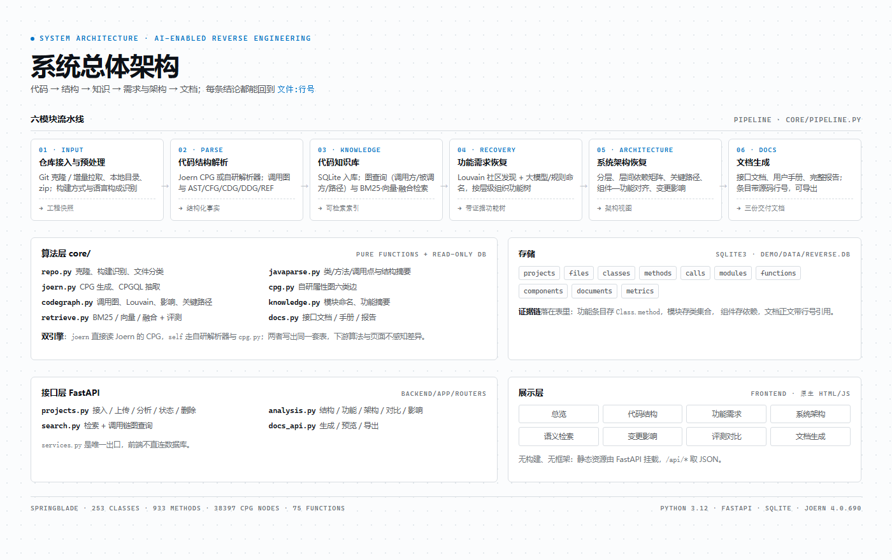
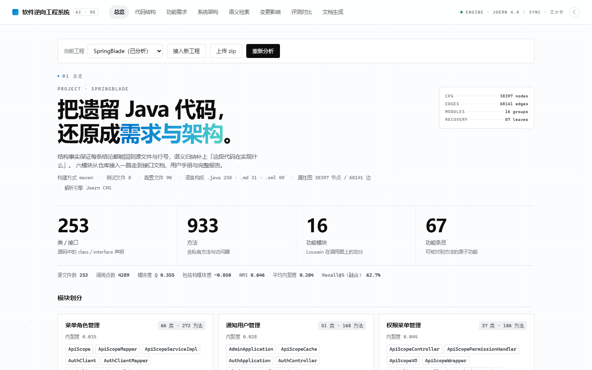
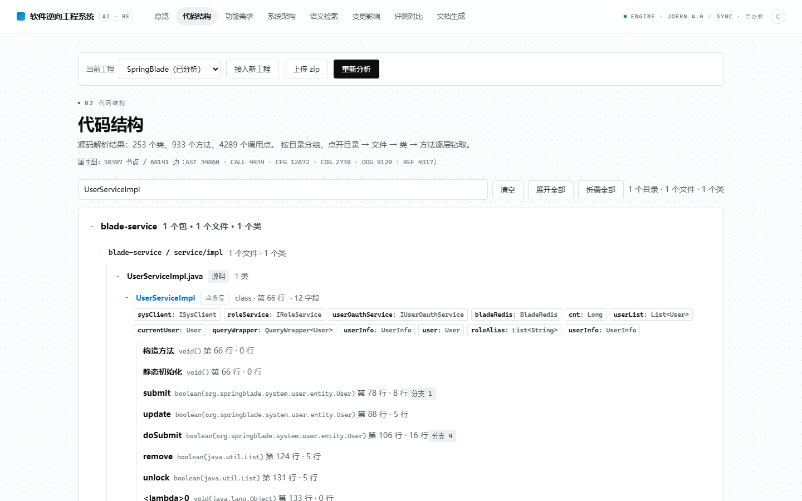
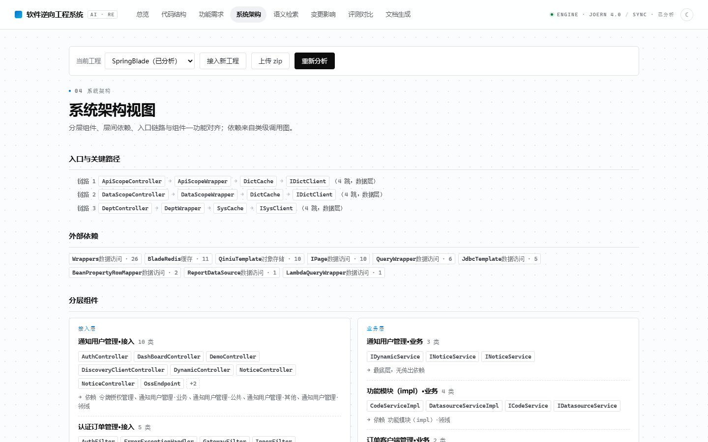
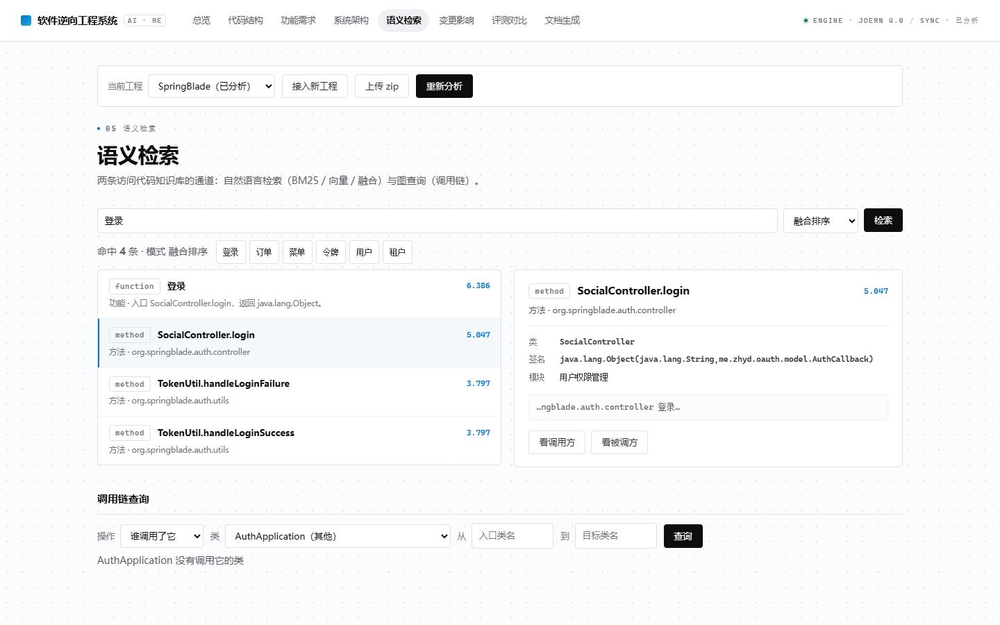
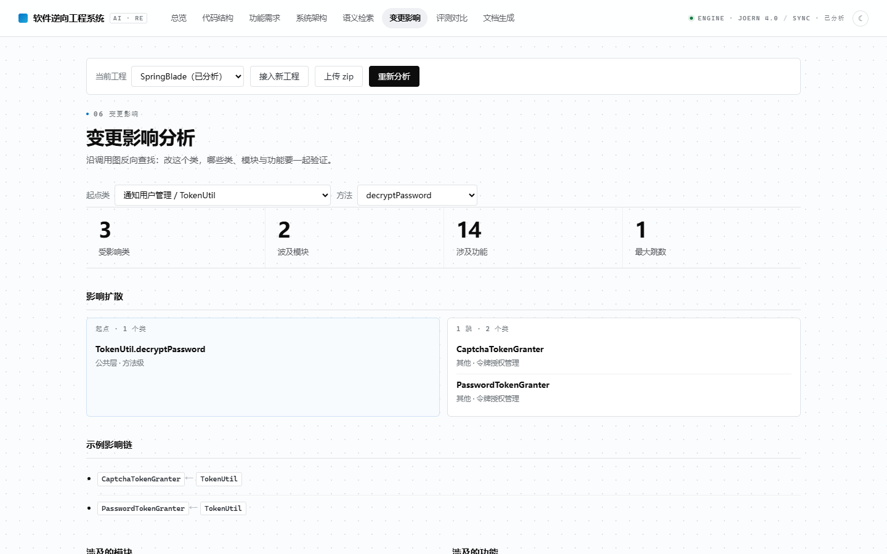
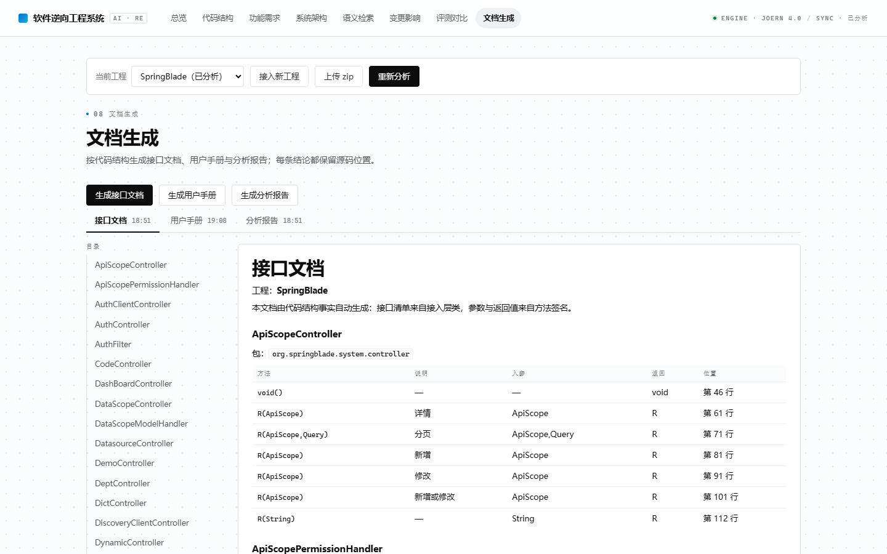

# AI 赋能的软件逆向工程系统 · 系统框架设计（demo）

> 对应毕设简介「3.主要工作任务」的六个模块。本文是 demo 的框架设计说明：每个模块落到哪张表、哪个接口、哪个页面、哪份代码，以及哪些是完整实现、哪些是演示级近似。
>
> 代码预算：后端 Python 约 1.8k 行（不含示例工程生成脚本），前端约 0.7k 行，示例 Java 工程 0.6k 行；数据库 SQLite 单文件。

## 1. 目标与边界

**要回答的问题**：面对一个没有文档的 Java 工程，系统能否自动给出「这个系统有哪些功能、分几层、某个功能在哪里实现、改一处会波及什么、对外接口长什么样」。

**demo 的做法**：结构事实来自源码解析（类、方法、调用点、方法级结构摘要），语义来自社区发现 + 规则/大模型归纳，两者在数据库里按「结论 → 证据」的格式落库，前端只做读取与展示。所有结论都带证据指针（`Class.method`、文件行号、类集合）。

**演示级近似的部分**（下文逐条标注）：

| 简介要求 | demo 实现 | 说明 |
| --- | --- | --- |
| Joern 生成 CPG | 已实装：Joern 4.0.690 生成 CPG，CPGQL 抽节点与六类边（`core/joern.py`） | GitHub 直连不可达，经 `gh-proxy.com` 取到 `joern-cli-windows-x86_64.zip`，配 JDK 17 后 `joern-parse` 与本地 CPGQL 服务均可跑；`engine=self` 保留自研解析器（`core/cpg.py`）作为离线兜底 |
| CFG/CDG/DDG | 语句级导出 | 方法体切分为语句块，按顺序、分支与变量定义-使用建 CFG/CDG/DDG 边，落 `data/cpg/project-<id>.json` |
| 向量索引 + 嵌入模型 | 稀疏向量 + BM25 + 融合 | 词项加权与逆文档频率构造向量做余弦召回；融合先经「功能条目 → 证据方法」一跳再叠加调用图邻居 |
| Git 增量拉取 | clone / pull | 拉取全量；增量分析按「重新扫描」处理 |
| 导出 | Markdown 导出 | 报告按章节汇总为 .md 下载 |

## 2. 总体架构



自上而下四层：**六模块流水线**（仓库接入 → 结构解析 → 知识库 → 功能恢复 → 架构恢复 → 文档）、
**算法层 `core/`**（每个文件只做一件事，纯函数 + 只读数据库）、**存储**（SQLite 十张表）、
**接口与展示**（FastAPI 四个 router + `services.py` 单一出口，前端八个视图）。

一句话概括数据流：源码先被压成「类 / 方法 / 调用 / 结构摘要」，再被组织成图与索引，
最后由算法在图上做社区发现、分层与影响分析，把所有中间结论落表，页面只负责呈现与回溯。

模块与代码的逐一对应见第 3 节，表结构见第 4 节；`docs/arch-diagram.html` 是这张图的源文件
（用 Chrome 截图即可重新生成 `img/architecture-overview.png`）。

设计原则：

1. **结论与证据分离**：`functions` 存功能条目 + `evidence`（`Class.method`），`modules` 存模块 + 类集合，`components` 存组件 + 依赖；前端任何结论都能点回代码位置。
2. **流水线幂等**：每次分析先清空该工程的分析结果（`clear_project`），再按步骤写入；任一步失败写 `status='failed'` 与 traceback。
3. **双引擎 + 外部能力可选**：解析引擎可选 Joern（实装）或自研解析器；大模型、embedding 仍是可替换的「增强项」，缺省时有确定性兜底，保证现场可跑。

## 3. 六个模块 → 代码 / 表 / 接口 / 页面

### 模块 1：仓库接入与预处理

| 项 | 内容 |
| --- | --- |
| 职责 | Git 克隆/拉取、本地目录、zip 导入；识别 Maven/Gradle 多模块；文件分类（源码/测试/配置/资源）；语言构成与规模统计；筛出 Java 工程 |
| 代码 | `core/repo.py`（`clone`, `pull`, `detect_build`, `classify`, `scan`），`routers/projects.py`（`POST /api/projects`、`/upload`） |
| 表 | `projects`（root、file_count、loc、build_tool…） |
| 接口 | `POST /api/projects`（`{name, root}` 或 `{name, git_url}`）、`POST /api/projects/upload` |
| 页面 | 顶栏「接入新工程」「上传 zip」 |
| 产出 | 统一工程快照：文件清单 + 分类统计 + 构建方式 |

### 模块 2：代码结构解析

| 项 | 内容 |
| --- | --- |
| 职责 | 解析类/接口、方法、字段、调用点、javadoc；整理方法级结构摘要（分支/循环/catch/字段访问） |
| 代码 | `core/javaparse.py`（`parse_source`、`_parse_methods`、`_calls_in`、`_structural_facts`） |
| 表 | `classes`、`methods`、`calls`（caller/callee 均为类 id） |
| 接口 | `GET /api/projects/{pid}/structure` |
| 页面 | 代码结构（文件 → 类 → 方法 → 结构摘要） |
| 产出 | 结构化事实集合（供知识库与恢复模块使用） |

### 模块 3：代码知识库与语义检索

| 项 | 内容 |
| --- | --- |
| 职责 | 事实入库；按实体/调用链/依赖路径的图查询；代码片段检索；两路融合给恢复模块供上下文 |
| 代码 | `core/retrieve.py`（`build_index`, `search`, `evaluate`）、`core/codegraph.py`（`callers`, `callees`, `shortest_path`）、`routers/search.py` |
| 表 | 无独立表，索引在内存（`INDEXES`，按签名失效） |
| 接口 | `GET /{pid}/search?q&mode&k`、`GET /{pid}/graph?op=callers\|callees\|path` |
| 页面 | 知识库检索（检索 + 调用链查询） |
| 产出 | 结构、语义双通道可检索 |

### 模块 4：功能需求恢复

| 项 | 内容 |
| --- | --- |
| 职责 | 调用图（并合并包/类依赖边）上做社区发现 → 候选模块；结构特征 + 大模型归纳命名；按层级组织功能树；函数级需求条目挂证据 |
| 代码 | `core/codegraph.py`（`louvain`, `merge_small`, `attach_isolated`, `modularity`, `nmi`）、`core/knowledge.py`（`name_modules`, `guess_function_name`, `summarize_functions`）、`pipeline._build_functions` |
| 表 | `modules`（name/evidence/size/cohesion）、`functions`（level/name/summary/evidence/module_id/parent_id） |
| 接口 | `GET /{pid}/functions`、`GET /{pid}/compare` |
| 页面 | 功能需求（一级模块 + 二级条目 + 证据） |
| 产出 | 带证据的功能树与需求条目 |

### 模块 5：系统架构恢复

| 项 | 内容 |
| --- | --- |
| 职责 | 模块间依赖与跨模块调用；分层；耦合热点；关键路径（入口 → 核心流程）；组件—功能对齐；依赖矩阵；变更影响 |
| 代码 | `pipeline._store_components`、`codegraph.guess_layer`、`codegraph.impact`、`codegraph.critical_paths`、`services.architecture` |
| 表 | `components`（module_id/name/layer/classes/provides/depends_on） |
| 接口 | `GET /{pid}/architecture`（含 `matrix`、`component_functions`、`entries`）、`GET /{pid}/impact/{class_id}` |
| 页面 | 系统架构（分层组件 + 依赖矩阵 + 组件—功能映射）、变更影响 |
| 产出 | 架构视图与组件—功能映射表 |

### 模块 6：文档生成

| 项 | 内容 |
| --- | --- |
| 职责 | 接口文档（按模块/类/方法）、用户手册（按功能树）、完整报告（按章节汇总），支持导出 |
| 代码 | `core/docs.py`（`api_doc`、`manual_doc`、`report_doc`、`generate`、`render`） |
| 表 | `documents`（kind/title/content/created_at） |
| 接口 | `POST /{pid}/documents/{kind}`、`GET /{pid}/documents`、`GET /{pid}/documents/{id}`、`GET /{pid}/documents/{id}/export` |
| 页面 | 文档生成（三份文档 + Markdown 预览 + 导出） |
| 产出 | 三类交付文档 |

## 4. 数据模型

```
projects(id, name, root, created_at, status, step, error,
         file_count, loc, class_count, method_count, module_count,
         modularity, nmi, build_tool, test_count, config_count)
files(project_id, path, package, loc, category)
classes(id, project_id, file_id, name, package, kind, layer, module_id, start_line, doc)
methods(id, project_id, class_id, name, signature, return_type, params,
        line, loc, doc, is_public, branches, loops, catches)
calls(id, project_id, caller_id → classes.id, callee_name, qualifier, callee_id → classes.id, line)
modules(id, project_id, name, evidence, size, cohesion, method_count)
functions(id, project_id, module_id, parent_id, name, summary, evidence, level)
components(id, project_id, module_id, name, layer, classes, provides, depends_on)
documents(id, project_id, kind, title, content, created_at)
metrics(project_id, key, label, value, note)
```

关系：`projects 1—n files/classes/modules/functions/components/documents/metrics`；`classes 1—n methods`；`methods → calls.caller_id`、`classes → calls.callee_id`（调用边两端都落到类，便于构图）；`functions.parent_id` 自关联成两层功能树。

## 5. 流水线与进度

```
POST /analyze → status=running
  扫描源码        8%   repo.scan：文件分类、语言统计、构建方式
  解析结构       26%   javaparse：类/方法/调用点/结构摘要 → files, classes, methods, calls
  社区发现       58%   codegraph.louvain + merge_small + attach_isolated → modules
  归纳功能       70%   knowledge.name_modules + 功能树 → functions
  恢复架构       82%   分层组件、依赖矩阵、关键路径 → components
  计算指标       92%   modularity / NMI / Recall@5（四模式）→ metrics
  导出属性图     97%   engine=joern：CPGQL 抽节点与六类边；engine=self：cpg.build 落 data/cpg/
  完成          100%
```

状态机：`new → running → analyzed | failed`，`error` 存失败回溯；前端每 700ms 轮询 `/status`。

## 6. 算法接入（简介要求的「输入 / 输出 / 对比」）

| 算法 | 输入 | 输出 | 对比口径 |
| --- | --- | --- | --- |
| Louvain 社区发现 | 类级调用图（含包内依赖边） | 候选模块划分 | 与包结构划分比模块度 Q、NMI；minishop Q=0.533 / NMI=0.135，SpringBlade 归并后 Q=0.355 / NMI=0.646 |
| 检索排序（BM25 / 向量 / 融合） | 自然语言查询 | Top-k 代码位置 | 与整串关键词匹配比 Recall@5：minishop 20 条查询 融合 100% / BM25 70% / 向量 65% / 关键词 45%；SpringBlade 73 条查询 融合 65.8% / 关键词 50.7% / 向量 35.6% / BM25 32.9%（查询已去掉消歧后缀） |
| 大模型归纳（可选） | 模块内类名、方法名与结构特征 | 模块职责名、功能条目 | 与「只给代码不给结构」的启发式相比的命名一致性；未配模型时走规则，结论标注来源 |

融合通道的顺序是「查询 → 功能条目（BM25+向量）→ 证据方法 → 调用图邻居」，比单路多一次证据跳转，
因此在「查询来自功能条目」的评测集上领先最明显；这个前提写在评测结论里，不当作通用优势。

## 7. 与毕设简介的逐条对照

| 简介要点 | 状态 | 落地位置 |
| --- | --- | --- |
| Git 克隆与拉取、目录、压缩包导入 | 已实现 | `repo.clone/pull`、`POST /api/projects`、`/upload` |
| 识别 Maven/Gradle 多模块 | 已实现（识别，不解析模块依赖） | `repo.detect_build` |
| 文件分类与语言统计 | 已实现 | `repo.classify/scan`、总览指标 |
| Joern CPG | 已实现（`engine=joern`） | `core/joern.py`：`parse` → `serve` → CPGQL 抽类/方法/调用与 AST/CFG/CDG/DDG/REF 边；`engine=self` 走自研 `core/cpg.py` |
| CFG/CDG/DDG | 已实现（Joern 侧取自 CPG；自研侧语句级近似） | `engine=joern` 用 `cpg.call.cfgNext / cdgOut / dddIn` 统计边；`engine=self` 走 `cpg._statements/_method_graph` |
| 图查询（实体、调用链、依赖路径） | 已实现 | `GET /graph?op=callers\|callees\|path` |
| 向量检索 | 已实现（稀疏词项向量） | `retrieve._build_vectors/_vector_scores`，模式 `vector` |
| 社区发现 + 大模型命名 | 已实现（模型可选） | `codegraph` + `knowledge` |
| 功能树 + 证据挂接（过滤访问器与工具方法） | 已实现 | `functions` 表、`pipeline._is_accessor/TOOL_CLASS_RE` |
| 分层、耦合热点、关键路径、外部依赖 | 已实现 | `codegraph.guess_layer/critical_paths`、`pipeline._store_externals` |
| 组件—功能映射、依赖矩阵 | 已实现 | `services.architecture` |
| 变更影响查询 | 已实现（类级与方法级） | `codegraph.impact(pid, class_id, method)`、`/impact/{class_id}?method=` |
| 三类文档 + 导出 | 已实现 | `docs.generate`、`/export` |

## 8. 目录与代码预算

```
demo/
  backend/          3957 行 Python（29 个文件，含 routers/scripts，不含 gen_samples.py）
    main.py           入口、CORS、静态资源
    db.py             建表、列迁移、查询封装
    services.py       结果 → JSON（overview/structure/functions/architecture/graph/export）
    core/repo.py      接入预处理（目录/zip/Git、分类、构建方式、语言统计）
    core/javaparse.py Java 解析（类/方法/调用点/结构摘要）
    core/joern.py     Joern 引擎：joern-parse → CPGQL 服务 → 抽类/方法/调用与六类边
    core/cpg.py       自研引擎的属性图导出（AST/CALL/CFG/CDG/DDG/REF）
    core/codegraph.py 调用图、社区发现、分层、关键路径、图查询、影响分析
    core/knowledge.py 模块命名与功能摘要（LLM 或启发式）
    core/retrieve.py  BM25 / 向量 / 融合检索与 Recall@5
    core/pipeline.py  分析流水线（六步）
    core/docs.py      三类文档与 Markdown 渲染
    routers/          projects / analysis / search / docs_api
  frontend/         850 行（index.html + app.js + style.css）
  samples/minishop/ 778 行 Java（20 个业务类 + 1 个测试类）
  samples/springblade/ 17484 行 Java（253 个类，来自 Gitee 上的 SpringBlade）
  backend/scripts/gen_samples.py 803 行（仅生成示例工程，不计入产品代码）
```

产品代码约 4.8k 行（后端 4.0k + 前端 0.85k），其中算法与生成部分集中在 `core/` 八个文件；
示例工程与生成脚本另计。较「1~2k」的预估偏大，主要是把六模块的界面与接口都做实了，
如果只保留后端流水线，核心约 1.5k 行；接入 Joern 后 `core/joern.py` 与抽取脚本又加了约 500 行。

## 9. Joern 引擎（实装说明）

```bash
# 1) JDK 17（GitHub 不可达时用华为云镜像）
curl -L -o tools/jdk17.zip https://repo.huaweicloud.com/openjdk/17.0.2/openjdk-17.0.2_windows-x64_bin.zip
# 2) joern-cli（GitHub 直连不通，经 gh-proxy.com 代理）
curl -L -o tools/joern-cli.zip \
  https://gh-proxy.com/https://github.com/joernio/joern/releases/download/v4.0.690/joern-cli-windows-x86_64.zip
# 3) 解压到 tools/jdk17/jdk-17.0.2 与 tools/joern/joern-cli，并建可写的 tools/tmp
```

抽取流程（`core/joern.py`）：`joern-parse <工程> -o <bin>` → `joern.bat --server --server-port <port> <bin>`
→ `POST /query`（body 只有 `{"query": "..."}`）拿 `uuid` → `GET /result/<uuid>` 取 `stdout` → 关服务。
踩过的坑写在代码注释里：`TMP/TEMP` 必须可写（否则 `File.createTempFile: 拒绝访问`）、
CPGQL 里的制表符要写成 `\\t`、返回值是三引号字符串需手工反转义、`c.filename` 只有方法节点有。
`joern-export` 不可用（graphson 按方法拆文件触发 Windows 路径超长，neo4jcsv 不支持 `cpg14`）。

SpringBlade 实测：253 类 / 933 方法 / 4289 调用，属性图 38397 节点、68141 边
（AST 34860、CALL 4434、CFG 12672、CDG 2738、DDG 9120、REF 4317），端到端约 85 秒。

边的一处口径差异要讲清楚：AST/CFG/CDG/CALL/REF 都是图里落盘的边，直接用
`cpg.all.out("<标签>").size` 数；REF 是 Joern 自己的引用边（标识符与调用指向声明，
4317 条），不是靠成员/参数节点估的。DDG 不同：`cpg.all.out("DDG")` 为 0，图里没有落盘，
9120 是 `cpg.call.ddgIn` 让数据流引擎按需算出来的，所以界面上给它标了「数据流引擎按需计算」。
两者放在同一张表里对比时，前者可复跑，后者依赖数据流 overlay 是否开启，答辩时按这个口径解释。

## 10. 界面

八个视图都用同一套版式：顶栏横导航 + 等宽 HUD（引擎 / 同步状态），正文按「眉标 → 标题 →
内容」排布，底部状态页脚。截图取自 SpringBlade（253 类 / 933 方法 / 16 模块 / 73 功能条目，
`engine=joern`），也就是系统的规模上限。

### 10.1 总览

首屏是 hero 大标题 + 右侧 CPG/EDGES/MODULES/RECOVERY 四项等宽指标，下面一层是四个规模
大数字（类 / 方法 / 模块 / 功能条目），再往下是模块卡片网格与产物入口。



### 10.2 代码结构

按目录分组（模块 → 包 → 文件 → 类 → 方法五级），支持按路径 / 包名 / 类名过滤，过滤时逐级
自动展开；每个方法带源码行号、分支/循环/捕获计数与调用点。



### 10.3 系统架构

入口与关键路径（从接入层入口出发的最长调用链）、外部依赖（缓存 / 消息 / 对象存储 / 数据访问库，
按名字与调用次数列出）、分层组件（接入 / 业务 / 数据 / 领域 / 公共），层间依赖矩阵与组件—功能对齐
放在可折叠区，避免长页。



### 10.4 语义检索

左侧命中列表（method / class / function 三类文档，带分数），右侧详情给出类、签名、所属模块与
分层，并可直接跳到「谁调用了它 / 它调用了谁」的图查询；模式可选融合 / BM25 / 向量 / 关键词。



### 10.5 变更影响

起点可选类或方法：选到方法时只从该方法的调用方开始扩散（例如 `TokenUtil.decryptPassword` 只波及两个
令牌生成器），不选方法则按类级调用关系扩散。页面按跳数分栏展示（起点 → 1 跳 → 2 跳 …），
给出四个数字（受影响类 / 波及模块 / 涉及功能 / 最大跳数）与从最深目标回溯的示例影响链；
类名可点，跳到代码结构页定位。起点默认取被调用最多的类。



### 10.6 文档生成

三类文档做成标签页，左侧按正文 `h2` 自动生成目录、右侧独立滚动预览，支持导出 Markdown；
顶部的生成按钮分别对应接口文档、用户手册与完整报告。



## 11. 运行

```bash
cd demo/backend
pip install -r requirements.txt
python run.py            # http://127.0.0.1:8100
```

演示顺序：接入 `demo/samples/minishop`（自研引擎，秒级）看总览指标 → 代码结构钻取到方法 → 功能树
→ 架构分层与依赖矩阵 → 知识库检索/调用链 → 变更影响 → 生成三类文档并导出；
再接入 `demo/samples/springblade`（解析引擎选 Joern，约 85 秒）看大规模工程的属性图统计、
16 个模块、层间矩阵与四模式召回。
